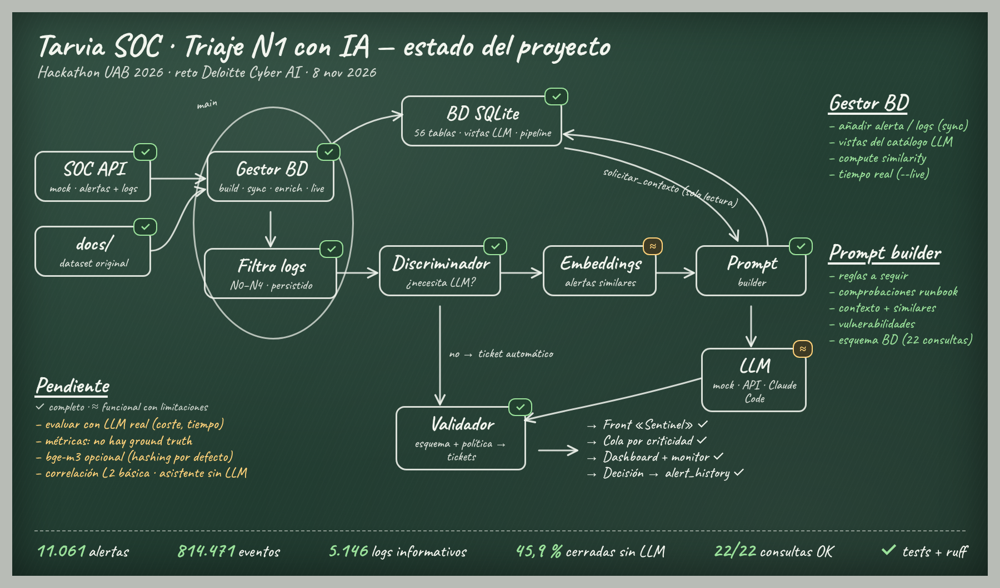

# Estado del proyecto · Tarvia SOC (8 nov 2026)



Leyenda: ✓ completo y validado · ≈ funcional con limitaciones conocidas.

## Flujo implementado

```
SOC API / docs ─► Gestor BD (build · sync · enrich · live) ─► BD SQLite
  ─► filtro de logs N0–N4 (persistido) ─► discriminador ─┬─► ticket automático (sin LLM)
                                                         └─► embeddings (similares) ─► prompt ─► LLM ⇄ BD (solo lectura)
  ─► validador (esquema + política) ─► triage_tickets ─► front Sentinel (cola por criticidad, decisión) ─► alert_history
```

## Estado por paquete (`src/`)

| Paquete | Estado | Qué hace | Limitaciones |
|---|---|---|---|
| `database/` | ✓ | `build` (56 tablas, 814.471 eventos, 11.061 alertas), `sync` (ingesta desde la SOC API), `enrich` (vistas del catálogo LLM, `dim_log`, `dim_context`, matriz de severidad, tablas del pipeline; incremental), `live` (copia sin alertas para tiempo real) | La BD ocupa ~780 MB con la capa derivada |
| `log_noise_discard/` | ✓ | Selección de logs informativos (N0–N4): 5.146 informativos; resultado persistido en `alert_log_selection` | Lee `docs/` (mismo dataset que la API); una alerta desconocida para el filtro se guarda como `unfiltered` (todos sus logs cuentan como informativos) |
| `triage_flow/` (nuevo) | ✓ | Orquestación: preparar, discriminador, similares, persistencia de tickets, lotes y modo `--live` | — |
| Discriminador | ✓ | Cierra sin LLM las alertas cuyos logs citados están todos explicados por contexto (N4/N1), no high/critical ni OT: 5.075 de 11.061 (45,9 %) | Sin ground truth para medir su precisión |
| `embeddings/` | ≈ | Vectores por alerta en `alert_embeddings`; alertas similares ya resueltas en el prompt | `bge-m3` solo si `sentence-transformers` está instalado; si no, codificador determinista por hashing |
| `prompt_builder/` | ✓ | `DbContextSource` (contexto desde la BD) + bloque de alertas similares; el catálogo de 22 consultas funciona sobre vistas reales (ms por consulta) | — |
| `llm_triage/` | ≈ | `DbToolBackend` (solo lectura), servidor con API para el front (`/api/queue`, `/api/tickets/{id}`, `/api/history`, `/api/stats`, `/api/decision`, `/api/batch`) | Validado con el LLM simulado; falta evaluar calidad, coste y tiempo con Claude real |
| `frontend/` | ✓ | Rediseño Sentinel conectado a la API: cola por criticidad, investigación con evidencias y traza, decisiones, histórico, analítica, monitor del pipeline y tiempo real | El asistente IA filtra la cola en local (no llama al LLM) |

## Cómo ejecutarlo (PowerShell)

```powershell
python -m src.database.build                      # BD base (≈1 min)
python -m src.database.enrich                     # capa derivada (≈15 s, incremental)
python -m src.main --no-sync --limit 50           # lote con LLM simulado
python -m src.llm_triage serve --mock             # front en http://127.0.0.1:8765

# Tiempo real (con scripts\mock_api.ps1 arrancado en otra terminal)
python -m src.database.live
python -m src.llm_triage serve --mock --db data/tarvia_live.sqlite --live 10 --live-batch 3
```

`--mode claude-code` (o `serve --claude-code`) usa el LLM real con la sesión del plan; sin flag, la API de Anthropic.

## Validación

- `pytest`: suite completa en verde, incluidas las pruebas nuevas de `tests/test_triage_flow.py` (discriminador, tickets, selección, similares, backend, copia live e integración sobre la BD) y las 26 de integración de la ingesta.
- `ruff check .` y `ruff format --check .` sin errores.
- Front: sin errores de consola y sin desbordamiento en escritorio (1600 px), tableta (1024 px) y móvil (390 px).

## Pendiente

1. Evaluar con el LLM real una muestra por runbook (calidad del veredicto, consultas pedidas, coste y latencia).
2. Definir una muestra etiquetada para medir el discriminador y los veredictos.
3. Instalar `bge-m3` en la máquina de la demo, o mantener el codificador por hashing.
4. Correlación L2 más allá de duplicados y cambios autorizados; asistente del front conectado al LLM.
