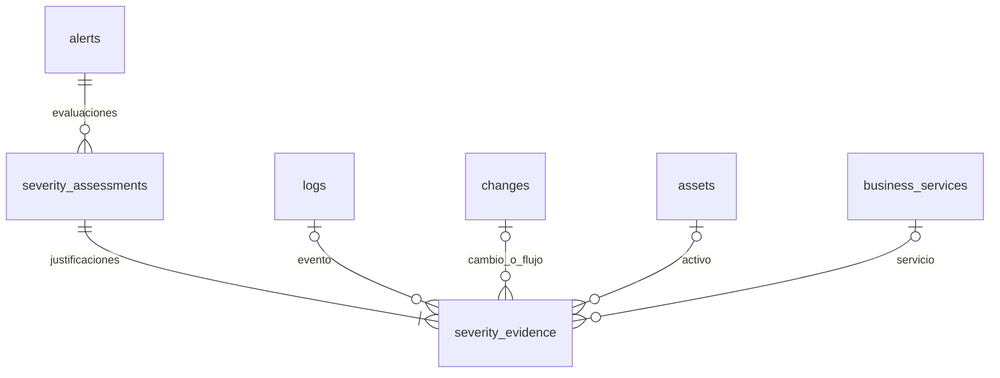

# Evaluaciones de severidad y evidencias

Cada triaje válido guarda su ticket y una evaluación de severidad en la misma transacción. Una evaluación nueva se añade al histórico: no reemplaza las anteriores, aunque cambie el inventario o se vuelva a triar la alerta. Los intentos de ticket no válidos no se registran como una decisión final de severidad.

## `severity_assessments`

| Campo | Contenido |
|---|---|
| `assessment_id` | Identificador de esta versión de la evaluación |
| `alert_id` | FK a la alerta evaluada |
| `rule_severity`, `criticality`, `base_severity` | Entradas y resultado de la matriz |
| `adjustment` | −1, 0 o +1; NULL para una excepción que no representa un desplazamiento de un nivel |
| `final_severity`, `verdict` | Resultado y veredicto del ticket en ese momento |
| `method` | `matrix`, `adjustment`, `authorised_activity` o `discriminator` |
| `rationale` | Justificación de la severidad final |
| `rules_version`, `policy_hash` | Versión del cálculo y SHA-256 de la política utilizada |
| `input_snapshot_json` | Valores considerados, fila de matriz, criticidades de inventario, relaciones y datos no resueltos tal como se observaron para el cálculo |
| `observation_start`, `observation_end` | Intervalo de observación cuando una regla lo requiera; actualmente NULL |
| `assessed_at` | Momento de registro en UTC |

Para `method = matrix`, la base y la severidad final tienen que coincidir y el ajuste tiene que ser 0. La evaluación también tiene que coincidir con la severidad, el veredicto y la justificación del ticket que se guarda.

## `severity_evidence`

| Campo | Contenido |
|---|---|
| `evidence_id`, `assessment_id` | Evidencia y FK a su evaluación |
| `condition` | Qué entrada, relación o condición se está justificando |
| `status` | `confirmed`, `refuted`, `unknown` o `not_evaluated` |
| `source`, `source_key` | Tabla, componente o regla de origen y clave de consulta |
| `event_id`, `change_id`, `asset_id`, `service_id` | FK opcionales a las fichas o eventos que sustentan la evidencia |
| `reference` | Referencia documental o de contexto |
| `finding` | Hallazgo concreto que se registra |
| `details_json` | Copia de los valores que sustentan ese hallazgo |

Las evidencias actuales documentan las criticidades de activos y servicios, las relaciones por las que se recuperaron y el cruce de la matriz. Las evidencias de los cierres del discriminador conservan los eventos y las referencias de contexto que ese código utilizó. Una relación con `changes` identifica la fuente citada; no demuestra por sí sola que toda la actividad estuviera autorizada.

Las evidencias del cálculo se construyen con datos del sistema, separadas del campo `evidence` que pueda entregar el modelo. El cambio no introduce reglas nuevas de subida, bajada o actividad autorizada.

## Decisiones heredadas de duplicados

Un cierre por duplicado añade una evidencia `inherited_decision`. En `details_json` conserva `source_alert_id`, `source_assessment_id`, el motivo de agrupación y copias de los datos de origen. `source = severity_assessments` y `source_key` identifican la evaluación concreta utilizada, no la evaluación más reciente que pueda tener la alerta en el futuro.

La referencia se selecciona junto al ticket de origen. Al guardar el duplicado se comprueba que esa evaluación existe, pertenece a la alerta indicada y coincide con la severidad, el veredicto y la justificación heredados. Un nuevo triaje de la alerta original no modifica la referencia del duplicado. Se aprovechan los campos de referencia y JSON existentes de `severity_evidence`, sin cambiar el esquema de la tabla.

Si el ticket de origen es antiguo y no tiene una evaluación coincidente, se conserva su copia y la alerta de origen, con `source_assessment_id = NULL` y estado `unknown`. No se inventa una versión ni se vincula una evaluación que no corresponda. Las explicaciones N4 de la alerta duplicada no se presentan como el motivo de un cierre que realmente se decidió por herencia.

## Ajustes pendientes

Los ajustes +1/−1 se registran como `not_evaluated`: no se convierten en condiciones falsas ni se inventa una ventana de observación. Cuando se implementen, cada condición deberá guardar su resultado, los campos concretos de los eventos utilizados y las referencias a la autorización cuando proceda.

La excepción determinista existente del discriminador se registra como `method = discriminator`, `adjustment = NULL`. Así queda visible, por ejemplo, un paso de base `medium` a `informational` sin presentarlo como un ajuste −1.

## Consulta y ciclo de vida

- El esquema está en `src/database/pipeline.sql` y se incorpora de forma idempotente al preparar la base.
- `store.get_ticket()` y `GET /api/tickets/{alert_id}` devuelven `severity_assessments`, con sus evidencias y las versiones más recientes primero.
- La persistencia está en `src/triage_flow/severity_audit.py`; las lecturas no cambian el inventario ni recalculan evaluaciones antiguas.
- La copia para simulación en tiempo real vacía primero estas tablas, preservando la base original.
- Los tickets antiguos sin estas evaluaciones no reciben una justificación retrospectiva inventada; las evaluaciones se generan con nuevos triajes válidos.
